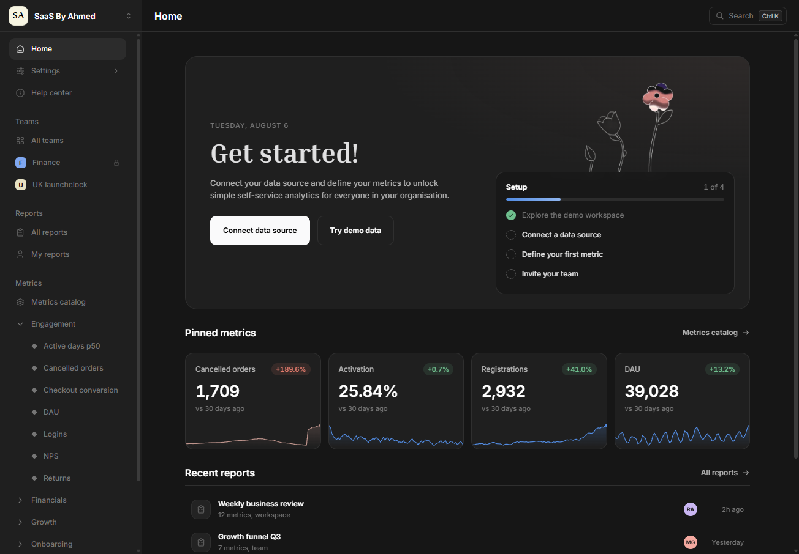
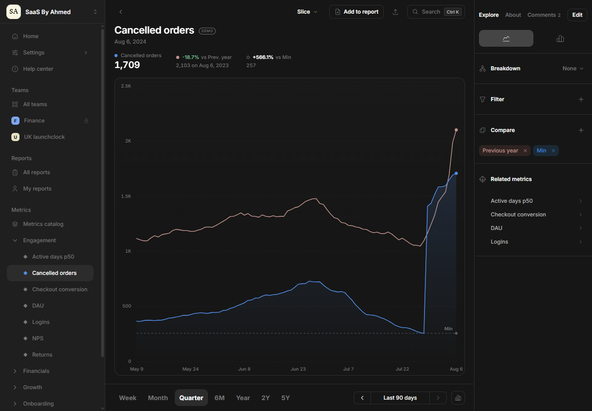
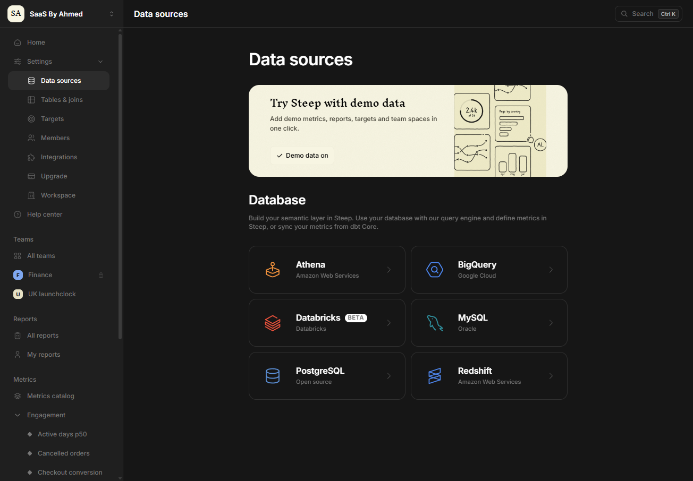
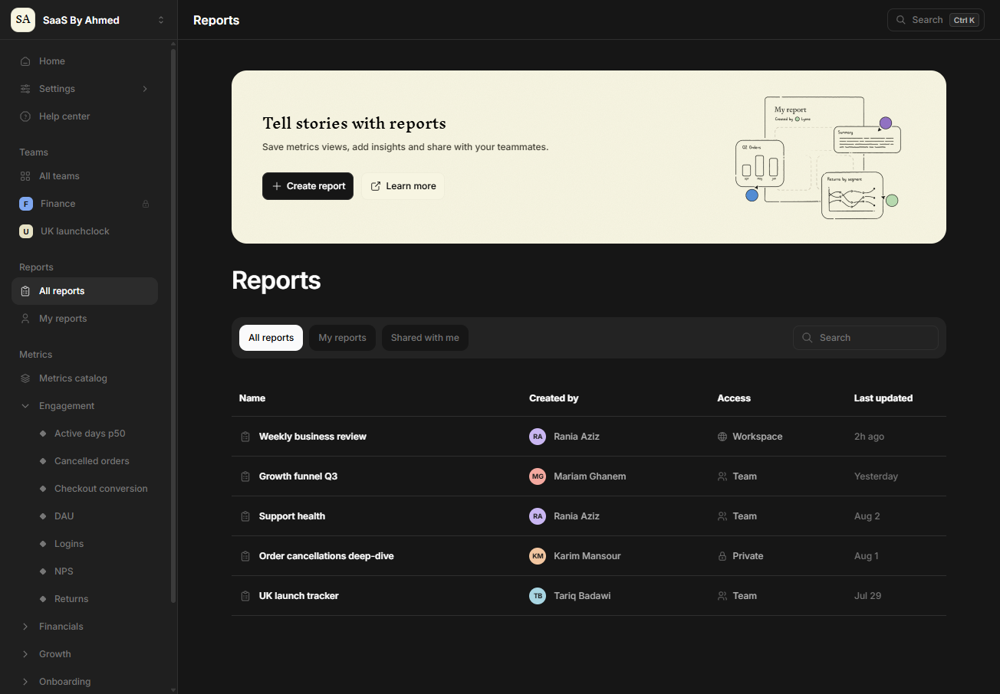
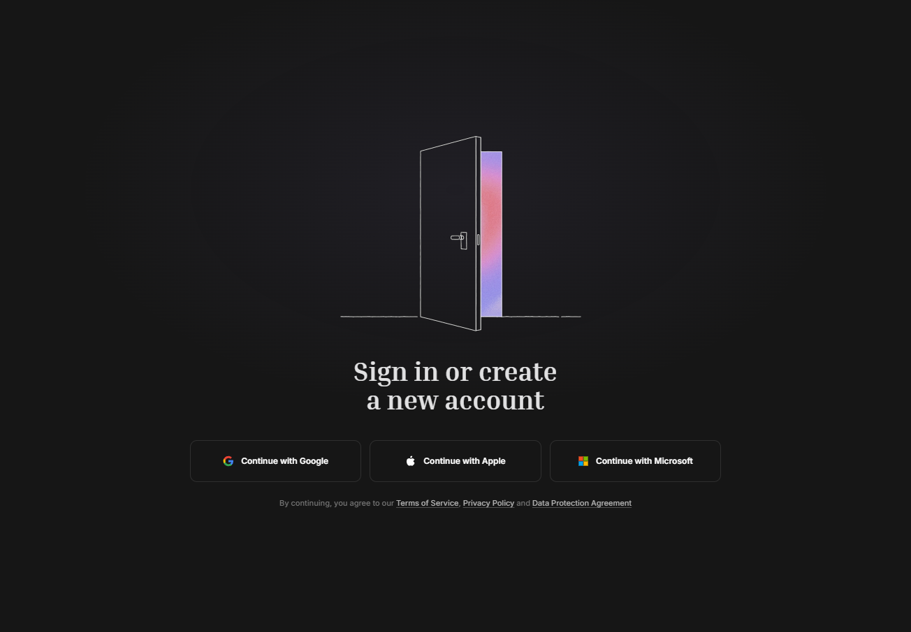

# SaaS Analytics Dashboard

A modern, dark SaaS analytics dashboard sample built with React, TypeScript and Vite.



## Features

- Overview home with setup checklist, pinned KPIs and recent reports
- Interactive metric charts with hover tooltips, period ranges, comparisons and breakdowns
- Metrics catalog, reports, teams and settings pages
- Data source connection flow
- Command palette (`Ctrl K`)
- Responsive layout

## Getting started

```bash
npm install
npm run dev
```

## Screenshots

| Metric dashboard | Data sources |
| --- | --- |
|  |  |

| Reports | Sign in |
| --- | --- |
|  |  |
